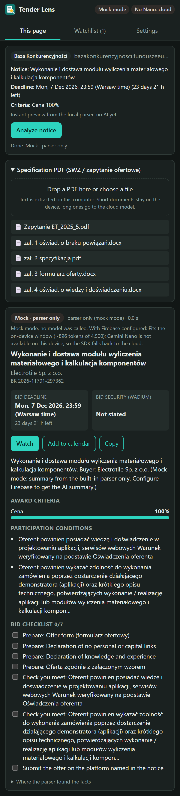

# Tender Lens

A Chrome extension that reads public tender notices and turns them into a bid checklist: deadline, bid security (wadium), participation conditions, award criteria and the documents you have to attach.

It is built for small companies and freelancers bidding in Polish public procurement, where every notice is long, written in legal Polish, and the one line that matters (for example *"Zamawiający wymaga wadium: Tak"*) sits between pages of GDPR clauses. The UI is in English; the notices can be Polish or English.

AI runs through **Firebase AI Logic hybrid inference**: Gemini Nano inside Chrome when the notice fits on the device, Gemini in the cloud for long specification PDFs or when Nano is not available. The panel always shows which one answered and why.

Built for [#BuildHybridAI 2026](https://firebasehybridaihackathon.devpost.com/) (platform: Web / Chrome extension).



## What it does

- **Works on the pages bidders actually use:** e-Zamówienia / BZP (`ezamowienia.gov.pl`), Baza Konkurencyjności (EU-funded requests for quotation, read through its public JSON API), and TED (EU Official Journal). On any other site you can select the notice text and use the context menu.
- **Instant preview, no AI yet:** a local parser reads the fixed-format fields (BZP sections 6.4, 8.1, 4.3.x, TED deadlines with UTC offsets, Polish dates like *"3 grudnia 2026 r. do godz. 12:00"*, amounts like *"21.000,00 zł"*) the moment the panel opens.
- **Hybrid AI summary:** plain-English summary, conditions, criteria, required documents and "watch out" items (references with minimum values, named staff, tight deadlines).
- **Long specifications (SWZ):** drop a PDF or click an attachment link. Text is extracted locally with PDF.js; short documents stay on the device, long ones (or scans without a text layer) go to the cloud model as the original PDF.
- **Checklist + watchlist:** tick off documents as you prepare them; watched tenders sync to Cloud Firestore and are sorted by deadline.
- **Calendar export:** one `.ics` event per deadline with reminders 3 days and 1 day before.
- **Trust checks:** dates and money from the parser win over the model. If the model reads a different deadline or amount, the panel shows both and tells you to check the notice.

## How the hybrid routing works

```
page / PDF ──► local parser (regex, instant) ──► facts: deadline, wadium, criteria, documents
     │
     └──► strip boilerplate locally (GDPR, platform manuals, sanctions law)
              │
              ├─ fits Gemini Nano window ───────────► PREFER_ON_DEVICE  (SDK falls back to cloud if Nano is missing)
              ├─ a bit too long ─► trim low-relevance lines ─► PREFER_ON_DEVICE
              ├─ long text / long PDF ──────────────► ONLY_IN_CLOUD     (cloud reads the original PDF)
              ├─ scanned PDF ───────────────────────► ONLY_IN_CLOUD
              ├─ "On-device only" setting ──────────► ONLY_ON_DEVICE    (long text split into several local passes, merged)
              └─ offline ───────────────────────────► ONLY_ON_DEVICE
                                   │
model JSON (same schema on device and in cloud) ──► merge passes ──► reconcile with parser facts ──► panel
```

If Gemini Nano returns something unusable in `PREFER_ON_DEVICE`, the request is retried once with `ONLY_IN_CLOUD`, and the route note says so. Every result shows the engine (**On device · Gemini Nano** / **Cloud · Gemini via Firebase AI Logic**), the model, the time and the routing reason.

The routing is pure TypeScript ([`src/core/router.ts`](src/core/router.ts), [`src/core/analyze.ts`](src/core/analyze.ts)) and covered by unit tests.

## Firebase products used

| Product | Where | What for |
|---|---|---|
| **Firebase AI Logic** (hybrid, Gemini Developer API) | [`src/ai/hybrid.ts`](src/ai/hybrid.ts) | `getGenerativeModel` with `InferenceMode.PREFER_ON_DEVICE`, `ONLY_ON_DEVICE`, `ONLY_IN_CLOUD`; one `Schema` used as `responseSchema` (cloud) and `responseConstraint` (Gemini Nano); `initializeDeviceModel()` with download progress; `response.inferenceSource` to show which engine answered |
| **App Check** | [`src/firebase/app.ts`](src/firebase/app.ts) | Required by AI Logic. Chrome extensions cannot use reCAPTCHA, so this build uses the **debug provider** (accepted by the hackathon rules). A `CustomProvider` is the slot for a production attestation backend |
| **Authentication** (anonymous) | [`src/firebase/services.ts`](src/firebase/services.ts) | Per-user watchlist without asking for an account (`firebase/auth/web-extension` build) |
| **Cloud Firestore** | [`src/store/watchlist.ts`](src/store/watchlist.ts), [`firestore.rules`](firestore.rules) | Watchlist and checklist state under `users/{uid}/tenders/{id}`, persistent local cache so it opens offline |
| **Remote Config** | [`src/firebase/services.ts`](src/firebase/services.ts), [`remoteconfig.template.json`](remoteconfig.template.json) | Tune the on-device token budget, the number of local passes and the cloud model without shipping a new build |

## Quick start without any keys (mock mode)

Needs Node.js 20+ and desktop Chrome 139+.

```bash
npm install
npm run build:mock
```

Open `chrome://extensions`, turn on **Developer mode**, click **Load unpacked** and choose the `dist` folder. Click the Tender Lens icon to open the side panel. In mock mode no model is called: you get the parser results and the routing decision the app *would* make.

## Full setup (Firebase AI Logic)

1. Create a Firebase project (the free Spark plan is enough) and add a **Web app**.
2. In the console: **AI Services → AI Logic → Get started**, choose **Gemini Developer API**. This also enforces App Check for AI Logic.
3. **Authentication → Sign-in method → Anonymous → Enable.**
4. **Firestore Database → Create database**, then paste [`firestore.rules`](firestore.rules) into the Rules tab and publish.
5. Optional: **Remote Config**, add the three parameters from [`remoteconfig.template.json`](remoteconfig.template.json).
6. `cp .env.example .env` and paste the web app config.
7. App Check debug token: run `npm run debug-token`, register the UUID in **App Check → Apps → (your app) → Manage debug tokens**, and put it in `.env` as `VITE_APPCHECK_DEBUG_TOKEN`. Never commit it or publish a build that contains it.
8. `npm run build`, then load `dist` as an unpacked extension.

This Spark setup is for local testing. Before distributing an extension that calls Gemini in the EEA, review the [Gemini API Additional Terms](https://ai.google.dev/gemini-api/terms): API clients made available in the EEA must use Paid Services. The mock build makes no Gemini calls. Never distribute the local App Check debug token.

### Gemini Nano

Gemini Nano needs desktop Chrome 139+, about 22 GB of free disk space for the download, and either a GPU with more than 4 GB of VRAM or 16 GB of RAM and 4+ CPU cores. Check `chrome://on-device-internals`. If Chrome reports it as *downloadable*, press **Settings → Download model** in the panel (the download needs a click). Until the download finishes, `PREFER_ON_DEVICE` requests go to the cloud.

Gemini Nano in Chrome 157 accepts English, German, Spanish, French and Japanese as declared input languages, not Polish, so the app declares English. The model still reads the Polish notice; the glossary in the prompt and the parser hints keep the key terms, dates and amounts right.

## Tests

```bash
npm test          # Vitest: parser, router, pipeline with a fake model, merging, calendar
npm run smoke     # loads dist/ into a throwaway Chrome profile and drives the panel (run after build:mock)
```

The parser tests run on real public notices saved in [`test/fixtures`](test/fixtures) (three BZP notices, one TED notice, two Baza Konkurencyjności API responses). Contact e-mails and phone numbers were replaced with placeholders.

## Project layout

```
src/core/       pure logic (parser, Baza Konkurencyjności adapter, cleanup, router, prompt, merge, .ics, checklist)
src/ai/         Firebase AI Logic hybrid model, Gemini Nano status, PDF.js text extraction
src/firebase/   app + App Check, anonymous auth, Remote Config
src/store/      watchlist (Firestore, or chrome.storage in mock mode)
src/capture/    the function injected into the tender page to read its text
src/sidepanel/  UI
src/background/ service worker: side panel, context menus, badge on tender sites
test/           Vitest + fixtures
scripts/        icon generator, Chrome smoke test
```

## Privacy

- Notice text is read only when you open the panel on a supported site or press Analyze.
- In **Auto** mode short notices are processed by Gemini Nano on your computer. Long documents, and everything when Nano is not available, are sent to Gemini through Firebase AI Logic; every result is labelled with the engine that produced it. **On-device only** mode never sends notice text to the cloud.
- Firestore stores only what you choose to watch: URL, title, buyer, reference, deadline, bid security, the short summary and your checklist. No page text.

## Limitations

- Chrome extensions have no production App Check provider out of the box. This build uses the debug provider, which is fine for the hackathon and for personal use; a public release needs a small token-minting backend behind the `CustomProvider`.
- The parser knows the formats of BZP, Baza Konkurencyjności and TED. Other platforms rely on the model and the free-text patterns.
- The extension helps you read a notice. It is not legal advice; always check the original documents.

## How it was built

Built during the #BuildHybridAI submission period (from 11 November 2026) by Maciej Kaczmarczyk with AI coding agents (Claude Code and Codex). No code from earlier projects. Third-party libraries: Firebase JS SDK and PDF.js (both Apache-2.0), installed from npm.

## License

[Apache-2.0](LICENSE)
